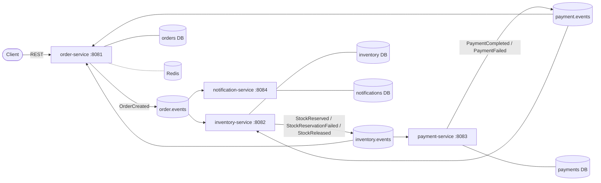

# Order Platform

[](https://github.com/aadityaa-dava/order-platform/actions/workflows/ci.yml)

An event-driven order-processing platform built to show how to keep data consistent across services **without distributed transactions**: choreographed sagas with compensating events, a transactional outbox, idempotent consumers, and failure handling that was verified by breaking the system on purpose and measured under load.

Four Spring Boot 3 services on Java 21 (order, inventory, payment, notification), Kafka in KRaft mode, one PostgreSQL database per service, Redis, Docker Compose, Testcontainers, Prometheus and Grafana, OpenTelemetry with Jaeger, k6 load tests, GitHub Actions. Everything runs locally and uses only free tools.

## What it demonstrates

- **Consistency without distributed transactions:** choreography saga; every state change and its event are written in one local transaction (outbox); delivery is at-least-once and every consumer is idempotent.
- **Idempotency end to end:** `Idempotency-Key` on the API, `processed_events` dedupe in every consumer, an idempotency key on the payment gateway call, unique constraints as the final guard.
- **Failure handling, tested:** crash a service mid-saga, a 60 s outage, a slow, declining and timing-out payment gateway; invariants checked afterwards (see below).
- **Evidence-based performance work:** open-model load tests, a diagnosed bottleneck, a fix, and before/after numbers.
- **Observability:** metrics, dashboards, alerts, structured logs with correlation ids, and traces that continue through the outbox.

## Architecture



Details: [architecture](docs/architecture.md), [event contracts](docs/events.md), [sequence diagrams](docs/diagrams/sequences.md).

## Key decisions

| Decision | Why | Record |
|---|---|---|
| Choreography saga, not orchestration | Few steps, clear ownership; no central coordinator to scale or fail | [ADR-0001](docs/adr/0001-saga-choreography.md) |
| Transactional outbox | No dual write: the event exists if and only if the state change committed | [ADR-0002](docs/adr/0002-transactional-outbox.md) |
| At-least-once delivery plus idempotent consumers | Exactly-once is not available end to end; this is the honest model | [ADR-0003](docs/adr/0003-delivery-guarantees-and-idempotency.md) |
| Trace context stored in the outbox row | One trace across an asynchronous hop | [ADR-0004](docs/adr/0004-trace-context-through-the-outbox.md) |
| 12 partitions and 12 consumer threads | Found by load testing: 3 threads capped throughput at about 22 orders/s | [ADR-0005](docs/adr/0005-partitions-and-consumer-concurrency.md) |
| No automatic timeout-cancel yet | A late payment after a cancel needs a refund flow; not shipped half-correct | [ADR-0006](docs/adr/0006-stuck-sagas-are-not-auto-cancelled.md) |

## Quick start

Prerequisites: Java 21, Docker Desktop, [k6](https://k6.io) (load tests only).

```bash
docker compose -f infra/docker-compose.yml up -d     # Kafka, 4 PostgreSQL, Redis, Prometheus, Grafana, Jaeger
./scripts/start-services.sh                          # the four services (SAMPLING=1.0 to record every trace)

curl -s -X POST localhost:8081/orders \
  -H 'Content-Type: application/json' -H 'Idempotency-Key: demo-1' \
  -d '{"customerId":"c1","customerEmail":"jane@example.com","currency":"USD","items":[{"sku":"SKU-RED-MUG","quantity":1,"unitPriceMinor":1000}]}'
# take the orderId from the response, then:
curl -s localhost:8081/orders/<orderId>              # PENDING, then CONFIRMED within a second
```

Sending the same request again with the same `Idempotency-Key` returns the same order, not a second one.

| UI | URL |
|---|---|
| Grafana (dashboards, provisioned) | http://localhost:3000 |
| Prometheus | http://localhost:9090 |
| Jaeger (traces) | http://localhost:16686 |

Helpful scripts: `scripts/saga-e2e.sh` (end-to-end saga scenarios), `scripts/poison-test.sh` (a poison message must not block a partition), `scripts/concurrency-test-inventory.sh` (concurrent reservations never oversell), `scripts/svc.sh stop|start <service> <port>` (crash one service).

Tests: `./mvnw verify` (needs Docker; Testcontainers starts real Kafka and PostgreSQL). On macOS, if Testcontainers cannot find Docker, set `DOCKER_HOST=unix://$HOME/.docker/run/docker.sock` and `TESTCONTAINERS_DOCKER_SOCKET_OVERRIDE=/var/run/docker.sock`.

## Performance (one laptop, everything on the same machine)

Open-model load (constant arrival rate), simulated payment gateway of about 126 ms per call. Saga duration = order created until final state, server-side.

| Offered rate | Original (3 consumer threads) p50 / p95 | Final p50 / p95 |
|---|---|---|
| 10/s | 609 / 859 ms | 252 / 352 ms |
| 20/s | 709 / 1,417 ms | 270 / 412 ms |
| 40/s | 14.5 s / **32.8 s** | 540 / 842 ms (*) |
| 60/s | not run | 336 / 682 ms |
| 100/s | not run | 2.1 s / 6.2 s |

(*) Measured after the thread and partition change but before the outbox poll change.

- Sustainable capacity went from about **22 to about 85 orders/s (3.8x)**: the bottleneck was payment consumer threads blocked in the gateway call (Little's law: 12 threads / 0.126 s is about 95/s; measured 93/s), not CPU.
- Lowering the outbox poll from 200 ms to 50 ms halved low-load latency and, as expected, did not change capacity.
- The next limit is the same consumer threads; next levers are listed in [benchmarks](docs/benchmarks.md) along with the method and limitations.

## Failure experiments

| Failure | Result |
|---|---|
| `kill -9` payment-service mid-load, restart 15 s later | 601 of 601 orders confirmed, 0 stuck, 0 dead letters |
| payment-service down for 60 s (300 orders) | all PENDING during the outage, all 300 confirmed 4 s after the restart |
| Slow gateway (400-600 ms) | no loss; above capacity the queue grows and drains (p95 24 s at 40/s) |
| 25% payment declines | 155 cancelled, 446 confirmed; reserved stock equals confirmed orders (compensation correct under load) |
| 30% gateway timeouts | all 300 confirmed through retries with the same idempotency key |
| After all runs | 78,414 payment rows for 78,414 distinct orders |

Full report: [failure experiments](docs/failure-experiments.md).

## Testing and quality

40 test classes: unit tests, integration tests (`*IT`, Testcontainers with real Kafka and PostgreSQL), schema-first contract tests for the event JSON, listener end-to-end tests, and a poison-message test. CI runs everything plus an 80% line-coverage gate on the core logic of each module (currently 87% to 98%: order 97.8, notification 96.0, payment 94.6, inventory 91.5, event-contracts 88.9, messaging library 87.3) and publishes the four images to GitHub Container Registry from `main`. See [testing](docs/testing.md).

## What broke along the way

[docs/what-broke.md](docs/what-broke.md) lists every real failure and how it was found. Examples: a Kafka lag metric that read 0 while a consumer was 487 records behind; my own stop script killing Docker's backend (it matched client connections on the port) and being misdiagnosed as a memory problem for days; a "permanent" setting that was not.

## Known limitations

- No authentication, API gateway or service discovery; single Kafka broker; single instance per service.
- The payment gateway is simulated; no refund flow, so stuck orders are not auto-cancelled ([ADR-0006](docs/adr/0006-stuck-sagas-are-not-auto-cancelled.md)). Nothing alerts yet on the age of the oldest PENDING order.
- Consumer retries are blocking (a failing message delays its partition); retry topics would avoid that at the cost of ordering.
- Benchmarks come from one laptop with the load generator on the same machine and one run per point. Not deployed on Kubernetes.
- Images are about 600 MB (full JRE base, fat jar); a layered jar or smaller base would shrink them.

## Repository layout

```
services/   order-service, inventory-service, payment-service, notification-service
libs/       platform-messaging (outbox, idempotent consumer, retry/DLT, observability), event-contracts, test-support
infra/      Docker Compose files, Prometheus rules, Grafana dashboards
loadtest/   k6 script, sweep and diagnosis scripts, raw results
scripts/    run, smoke, e2e and failure-experiment scripts
docs/       architecture, ADRs, events, testing, observability, benchmarks, failure experiments, what broke
```
