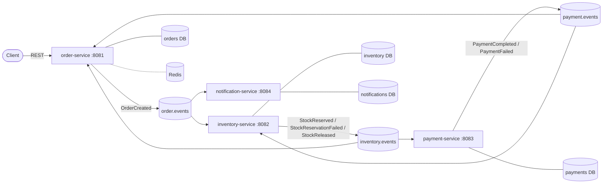

# Architecture

Event-driven order processing platform. Services own their data and communicate
only through Kafka events (saga by choreography, see ADR-0001).

## Components

## Service boundaries

| Service | Owns | Publishes | Consumes |
|---|---|---|---|
| order-service | orders, order items, order state machine, outbox | OrderCreated, OrderConfirmed, OrderRejected, OrderCancelled | StockReservationFailed, PaymentCompleted, PaymentFailed |
| inventory-service | stock levels, reservations, outbox | StockReserved, StockReservationFailed, StockReleased | OrderCreated, PaymentFailed |
| payment-service | payments, idempotency keys, outbox | PaymentCompleted, PaymentFailed | StockReserved |
| notification-service | sent notifications log | none | OrderConfirmed, OrderRejected, OrderCancelled |

Rules:
- One database per service; no service reads another service's tables.
- Each event type has exactly one producing service.
- Every consumer is idempotent (ADR-0003); every producer uses the outbox
  (ADR-0002), except notification-service, which only consumes.

## Order state machine (owned by order-service)

PENDING -> CONFIRMED (PaymentCompleted)
PENDING -> REJECTED  (StockReservationFailed)
PENDING -> CANCELLED (PaymentFailed, after stock is released)

CONFIRMED, REJECTED, and CANCELLED are terminal. Transitions out of a terminal
state are ignored (late or duplicate events cannot change the outcome).

## Kafka topology

| Topic | Producer | Key | Partitions (local) | Notes |
|---|---|---|---|---|
| order.events | order-service | orderId | 3 | |
| inventory.events | inventory-service | orderId | 3 | |
| payment.events | payment-service | orderId | 3 | |
| `<topic>.DLT` | consumer error handler | original key | 3 | dead-letter, one per topic (Phase 7) |

Design choices:
- Topic per producing service, event type carried in the message (an
  `eventType` field plus header). Fewer topics, per-producer ordering, clear
  ownership. Trade-off: consumers receive and skip event types they do not need.
- Key = orderId so all events for one order are ordered on one partition.
  Parallelism comes from many orders across partitions.
- 12 partitions locally; a real deployment would size from target throughput and
  consumer count.
- Kafka runs in KRaft mode (no ZooKeeper).

## Data and infrastructure

- PostgreSQL: one database per service (separate containers locally), schema
  managed by Flyway.
- Redis: order-service idempotency-key fast path and order-status cache. Never a
  source of truth; the database unique constraint is.
- Observability: Micrometer to Prometheus to Grafana; OpenTelemetry traces to
  Jaeger; structured JSON logs carrying orderId and correlation id.

## Out of scope (stated limitations)

- No authentication/authorization, API gateway, or service discovery.
- Single Kafka broker and single instance per service locally; no multi-region.
- Payment gateway is simulated, with configurable latency and failure rates.
