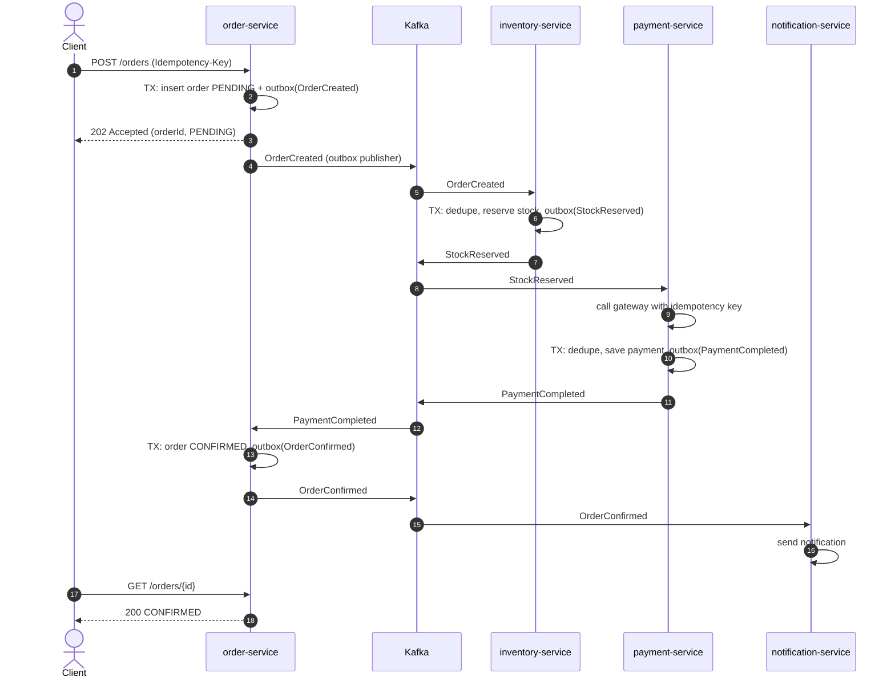
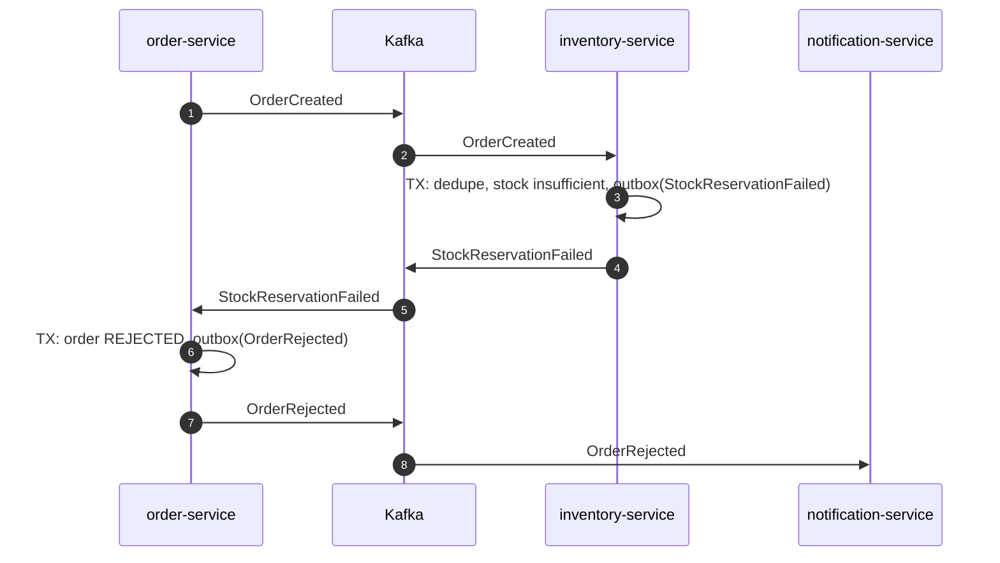
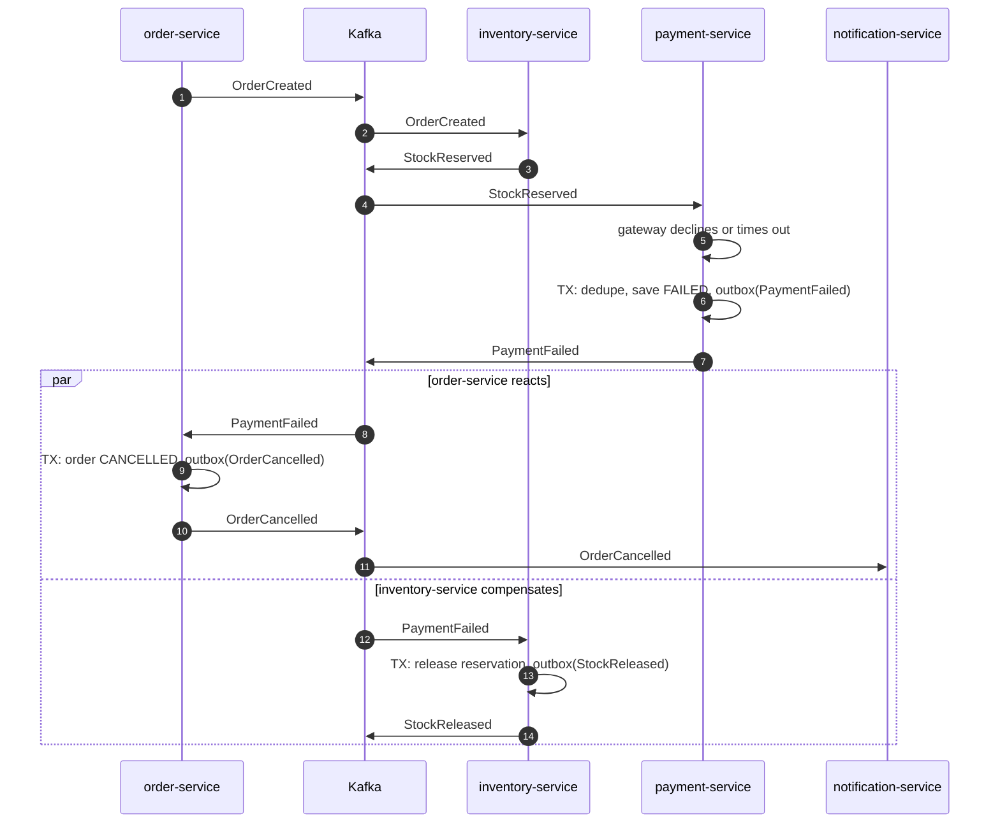

# Sequence diagrams

Kafka is shown as one participant; topics are order.events, inventory.events,
payment.events. "TX" means one local database transaction that includes the
outbox insert (ADR-0002). Every consumer step first dedupes on eventId
(ADR-0003).

## 1. Happy path

## 2. Failure: out of stock (no compensation needed)

Nothing was reserved or charged yet, so the saga just ends in REJECTED.

## 3. Failure: payment fails (compensating action)

Stock was already reserved, so it must be released before the order is
cancelled. Compensation is a new event, never a rollback.

## Notes for later phases

- Duplicate delivery of any message is a no-op (processed_events check).
- A message that keeps failing is retried with backoff, then sent to
  `<topic>.DLT` (Phase 7).
- In diagram 3, order-service and inventory-service act independently on
  PaymentFailed (choreography). The order can be CANCELLED slightly before the
  stock is released; this is eventual consistency and is acceptable because
  the order is already terminal.
